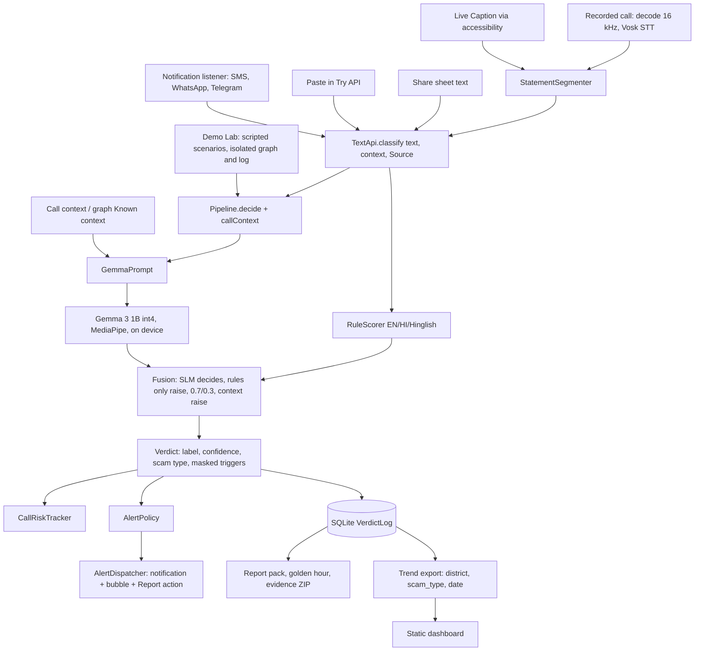

# ScamShield Architecture

Offline, on-device fraud shield for first-time digital users (Android, Flutter + Kotlin, package `com.hackasol.scamshield`). It judges what is being said, warns while it happens, and hands the user to the official channels with evidence ready (FINAL_PLAN §1). Citations in brackets point to `FINAL_PLAN.md`.

## 1. Pipeline

- One pipeline for every source; sources differ only in the `Source` enum value (CAPTION, PASTE, SHARE, SMS, WHATSAPP, NOTIFICATION, RECORDING, SIGNAL) (§2).
- Layering: deterministic logic is pure Kotlin in `core/` and unit-tested; the trained/on-device model and speech-to-text are the only learned parts; synthetic data generation is offline only (§3A).
- Default alert: heads-up notification for SCAM/SUSPICIOUS, bubble for live sources, both with a Report action (`AlertPolicy`, `AlertDispatcher`) (§2).

## 2. Fusion rule

- The SLM (Gemma 3 1B) decides the label. Strong rule matches can only raise it (SAFE to SUSPICIOUS, anything to SCAM), never lower it (§2).
- Confidence = 0.7 x Gemma + 0.3 x rule support for the final label; the weights live in one `FusionWeights` object in `core/Fusion.kt` (§2, §4 P1). When rules raise a label, the Gemma term is 0.5 (the model did not vouch for it).
- Context raise: claim-vs-context and context-rule hits (no matching bill/order event, non-DLT sender, link outside `.bank.in`/`.gov.in`, mistaken transfer, non-1600 bank call, delivery) are combined and can only raise the verdict, with reasons shown in the alert (§5). Weights are `[VERIFY]` heuristics.
- Scam type comes from the SLM output line (`GemmaPrompt` + `LlmOutputParser`: OTP, KYC, DIGITAL_ARREST, COURIER_CUSTOMS, FAKE_QR, LOAN_APP, INVESTMENT, JOB, MISTAKEN_TRANSFER, OTHER; SAFE has none). Rules-only mode falls back to a rule-derived type. No third classifier engine (§2).

## 3. SLM fine-tune and eval harness (`ml/`)

- Dataset: `data.py` defines `text,label,lang,scam_type,template_id,source`; the split is by scam template, and real rows go to the test set only (§6). `synth.py` is a deterministic EN/HI/Hinglish generator (44 templates per language, 10 scam types plus hard genuine negatives) that also emits SFT pairs in the on-device format (§3A).
- Parity: `prompt.py` and `parser.py` are Python ports of `GemmaPrompt.kt` and `LlmOutputParser.kt`, tested against the Kotlin-written `data/golden/prompt_golden.json` (§6). The golden grew to 21 entries when the graph "Known context" label was added.
- Harness: `eval_heldout.py` runs the held-out split through the same prompt and parser and reports precision, recall, FPR per language and scam-type macro-F1 for rules-only (from a Kotlin-exported JSONL), base Gemma, and fine-tuned Gemma. It writes `ml/reports/m1.json` and `docs/accuracy.md` (§6, M1).
- What was actually run (PROGRESS T1.14): rules-only and base Gemma 3 1B (HF bf16 on Apple MPS) on a SYNTHETIC held-out split of 26 rows, 0 real rows. Rules: precision 100.0%, recall 47.8%, FPR 0.0%, type macro-F1 0.31. Base Gemma: precision 100.0%, recall 91.3%, FPR 0.0%, type macro-F1 0.39. Only 3 of the 26 rows are negatives, so FPR 0 is weak evidence. The headline is "real" only with 100 or more real rows (§6); there are none.
- Not run: the LoRA fine-tune. `finetune.py`, `convert_task.py`, `configs/lora.yaml` exist and pass dry-run tests only; no GPU box, and the user decided the prototype ships base Gemma (PROGRESS Decisions 2026-11-23). The fine-tuned row is reported "future work" (§3A, §4 P1). Converter checks remain `[VERIFY]`.
- The shipped int4 `.task` has not been re-scored on a phone (device task T6.3, §6).
- Also built: HDBSCAN new-scam clustering on trigger features (`cluster.py`), for the dashboard (§1 bonus).

## 4. Sources

| Source | Path | Notes |
|---|---|---|
| Live Caption | `CaptionAccessibilityService` reads Live Caption text, `StatementSegmenter`, `TextApi` | Works for media on OnePlus 10T, not calls there; Pixel calls `[verify]`; no audio recorded (§2) |
| Notifications | `ScamNotificationListener` + `NotificationMapper` | SMS/WhatsApp/Telegram arrive as notifications; no `READ_SMS` (§2, §4 P2) |
| Paste / share | Try API and `ShareReceiver` (`text/plain`) | Try API shows scam-type chip and triggers; `ShareReceiver` is a translucent activity (source SHARE, classifies then alerts). Fake-QR text and a ML Kit "Scan QR" button feed `UpiQr`; shared `.apk` goes to `ApkGuard` (T2.1, T4.2, T4.3, T5.8) |
| Recorded call | file, `AudioDecoder`, `PcmResampler`, Vosk Hindi small model, `RecordingPipeline`, same `CallRiskTracker` | Offline; whisper.cpp is the fallback if Vosk WER is poor (§2). Vosk model (`vosk-model-small-hi-0.22`) downloads on device; Recording screen (SAF pick or shared `audio/*`) shows a per-statement timeline (T2.6, T2.7). Device run T2.8 pending (phone) |
| Demo Lab | 11 scripted synthetic scenarios, feature-flagged `demo_mode` (T8.1) | Source mix of SMS and call sources through the real `Pipeline`; works without a phone or model (rules-only) |
| In-call signals | `InCallSignals`: OTP, UPI app, AnyDesk during a call | Source SIGNAL; needs on-phone test (Current state) |

## 5. Verdict log

- `VerdictEvent{id, tsMs, source, label, confidence, scamType, triggers, engine}` stored by `SqliteVerdictLog` for every `TextApi` result on every source; the schema has no text column (§2, §4 P1).
- Consumers: Report pre-fill (`ReportPack`: money lost gives 1930 + cybercrime.gov.in; not yet gives Chakshu/Sanchar Saathi + 1930, `ACTION_DIAL` only), golden-hour mode (60-minute timer, case card, SHA-256-manifest evidence ZIP shared through FileProvider), trend export and dashboard counts (§2, §5).
- Dashboard: a static page over `{district, scam_type, date}` counts by district, type and week, loading synthetic sample data or a dropped export; `agg.mjs` rejects any extra key (§2, §6).
  Settings has a district picker and an "Export anonymised counts" share-sheet file via `TrendChannel` (T3.10).

## 6. Context layer (knowledge graph)

- A local graph of entities (sender, brand, order/bill/credit/out-for-delivery events, number, UPI ID) is fed only by new notifications, persisted by `PersistentKnowledgeGraph` (SQLite); one shared graph serves the listener and the caption/recording path (§5, §4 P5).
- `GraphContext.forMessage` hands the SLM at most 2 items under the label "Known context" (the call path keeps "Earlier in this call"): missing order/bill event for the claimed brand, first message from a sender, or cold-start text (§5).
- Call-side rules (mistaken transfer, bank caller not on 1600, delivery) now also run in production for CAPTION and RECORDING through `Pipeline.callContext`; claim-vs-context stays message-only, since ordinary calls mention bills (§5).
- Demo Lab (T8.1): enabled in debug, via a Settings switch, or 7 taps on the version row in release. It runs scripted scenarios through the same `Pipeline` shared with `TextApi` on a fresh in-memory graph and verdict log (never the real ones), and shows a 6-stage timeline (event, Known context sent to Gemma, masked rule hits, Gemma output, fusion with `raisedBy`, [DEMO] alert) with PASS/FAIL against expectations (§5, §6).
- Cold start: an empty graph says "No record since ScamShield was installed", never false certainty (§5).
- Rules (`ClaimVsContext`, `ContextRules`): mistaken transfer A (fake credit SMS) and B (return to a different UPI ID), bank call must come from the 1600 series, delivery within about 2 hours of an "out for delivery" event suppresses an alert, "parcel held, pay" without an order flags. Wording is `[VERIFY]` (RBI/NPCI) (§5).
- Fake-QR (`UpiQr`): parses `upi://pay?pa=&pn=&am=`, flags payee-name mismatch, frames "You will PAY Rs X to <name>" (§5). The Try API checker logs a FAKE_QR event without the link or VPA (T4.2); the scanner needs no CAMERA permission (T4.3).
- Also built: family code (offline RFC 6238 TOTP, no relay) (§5). APK guard scores requested permissions (`ApkRisk`: SMS + internet + contacts is HIGH) and warns before install; `[VERIFY]` weights (T5.8).

## 7. Privacy

- No raw message text is stored in the verdict log or the graph; triggers are masked before they are stored: every digit and UPI-like id becomes "•••" and triggers are length-capped in `RuleScorer`; genuine OTP notices stay SAFE (QA fixes 938c6d6, ea3f96e) (§2, §3A). Demo Lab data is synthetic and isolated from the real log.
- Nothing leaves the phone. The only outbound data is the user-initiated, anonymised trend export of exactly `{district, scam_type, date}`; the district is chosen by the user, SAFE verdicts are skipped, and the dashboard validator fails on any other key (§2, §6 Privacy).
- Models run on device; Gemma and Vosk are downloaded once, not per message. Airplane mode works for everything except model download (§6).
- Manifest has no `READ_SMS` and no `CALL_PHONE`: SMS arrive as notifications, and 1930 opens the dialer with `ACTION_DIAL`, never an auto-call (§2, §4 P2).
- No audio is recorded for live use; recorded-call audio is streamed to STT as PCM chunks and not written to disk (§1). Exception: the `MicProbe` device-test diagnostic saves a 3 s WAV locally (SCAMSHIELD_HANDOFF §5).
- Known prototype shortcut: the family-code secret sits in private SharedPreferences, to be moved to Keystore before release (PROGRESS Decisions).
- The base-model download has no pinned SHA-256 yet (`ModelConfig.SHA256` is null); pin before release (PROGRESS Model ids).
