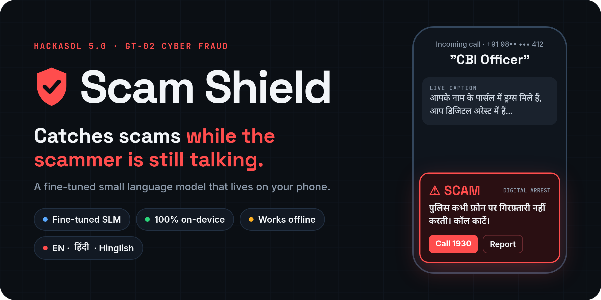
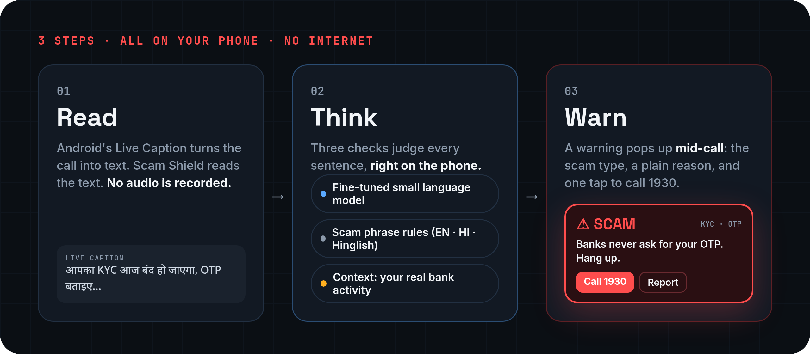
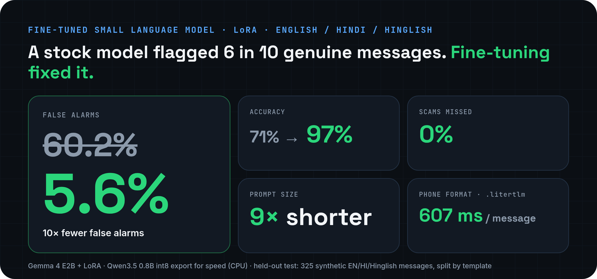
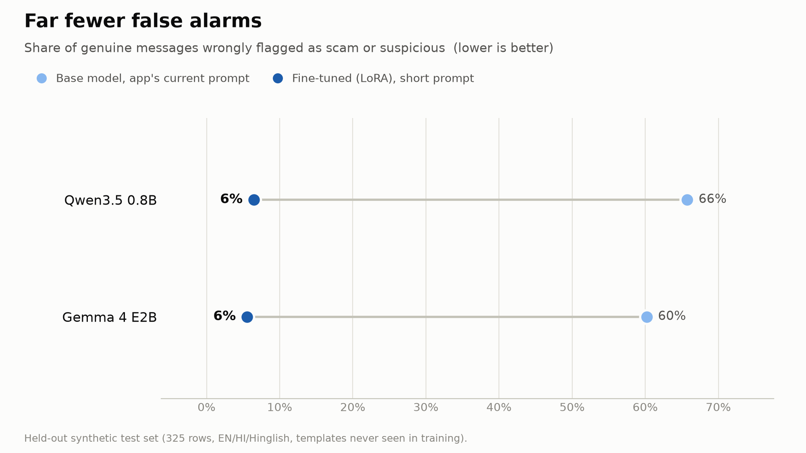
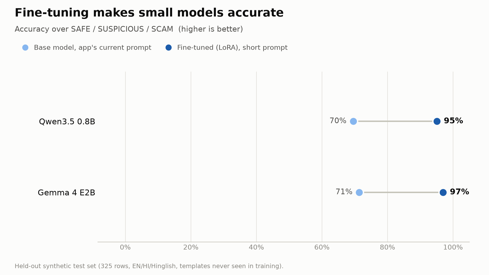
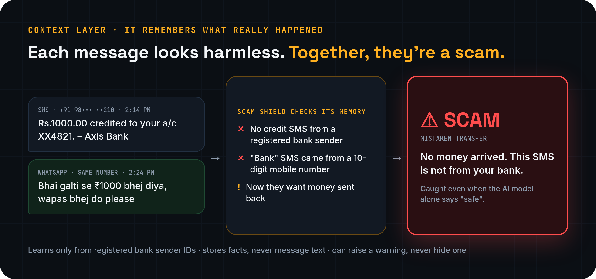
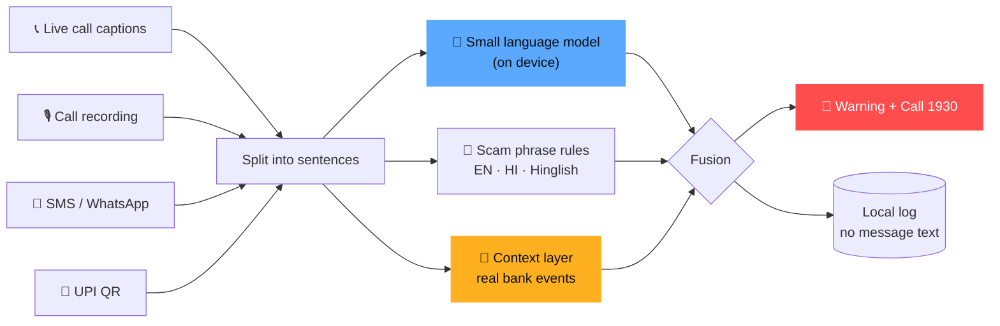

<p align="center">
  
</p>

<p align="center">
  
  
  
  
  
</p>

<h3 align="center">Truecaller tells you <i>who</i> is calling.<br>Scam Shield tells you if they're <i>lying</i>.</h3>

<p align="center">
  An Android app with a fine-tuned small language model that runs on your phone,<br>
  reads the call as it happens, and warns you mid-sentence.<br>
  <b>No cloud. No audio recording. Works in airplane mode.</b>
</p>

<p align="center">
  <a href="#-how-it-works">How it works</a> ·
  <a href="#-whats-inside">What's inside</a> ·
  <a href="#%EF%B8%8F-what-it-protects">What it protects</a> ·
  <a href="#-try-it">Try it</a>
</p>

---

## 🚨 The problem

> **₹107 crore** lost to cyber fraud in Chhattisgarh in 18 months. Only **₹3.69 crore** came back.

Once the money moves, it's almost never recovered. The only real fix is to **stop the scam while it's happening**.

Spam apps block **numbers**, but scammers buy a new SIM every day. What they never change is the **script**:

> *"You are under digital arrest."* · *"Your KYC expires today."* · *"I sent it by mistake, send it back."*

**Scam Shield catches the script.**

## ⚡ How it works

<p align="center"></p>

## 🧠 What's inside

### 1 · A fine-tuned small language model

<p align="center"></p>

A general-purpose AI panics at every bank SMS, and an app that cries wolf gets uninstalled. So we **fine-tuned small language models with LoRA** on **1,822 English, Hindi and Hinglish messages** written from 780 scam and genuine templates. The model returns a **label, a scam type and a plain reason**, and we exported it to **LiteRT (`.litertlm`)**, the format Android runs on-device.

<details>
<summary><b>See the full benchmark</b></summary>
<br>

| Model | Accuracy | False alarms | Scams missed | Scam-type F1 | Prompt tokens |
|---|---|---|---|---|---|
| Gemma 4 E2B: base → **fine-tuned** | 71.4% → **96.9%** | 60.2% → **5.6%** | 1.2% → **0.0%** | 0.42 → **0.92** | 618 → **68** |
| Qwen3.5 0.8B: base → **fine-tuned** | 69.5% → **95.1%** | 65.7% → **6.5%** | 0.0% → **2.4%** | 0.49 → **0.83** | 638 → **76** |

Qwen3.5 0.8B fine-tuned → merged → `.litertlm` int8 (754 MB): **607 ms per message** on CPU, 2.3× faster than the base model file.

<p align="center">
   
</p>

Everything, per language and per model: [`docs/benchmark.md`](docs/benchmark.md) · training and export code: [`ml/`](ml/)

</details>

### 2 · A context layer that remembers what really happened

<p align="center"></p>

Scam Shield keeps a **private memory on your phone** of real events: bank credits and debits, orders, deliveries, bills. That lets it catch scams that look innocent one message at a time:

| They say | Scam Shield knows | Result |
|---|---|---|
| "Sent you ₹1000 by mistake, send it back" | No real bank credit ever arrived | 🔴 **Scam: mistaken transfer** |
| "This is your bank calling" from a regular mobile | Banks call from 1600-series numbers | 🔴 **Flagged** |
| "Your parcel is held, pay customs" | No order or delivery on record | 🔴 **Flagged** |

It only learns from **registered sender IDs** (TRAI DLT headers), so scammers can't plant fake history. It stores **facts, never message text**. And it can only **raise** a warning, never hide one.

### 3 · Warnings in the middle of the call

Android's **Live Caption** already turns speech into text. Scam Shield reads that text, splits it into sentences, and judges each one as it arrives. It tracks risk **across the whole call**, so one odd line doesn't cause panic but a building pattern does. If captions are hidden, an **OCR fallback** reads them, Devanagari included.

It also watches for **red flags during a call**: an OTP arriving, a payment app opening, AnyDesk or screen sharing starting.

## 🛡️ What it protects

| | Channel | What happens |
|---|---|---|
| 📞 | **Live calls** | Warning bubble mid-call, with **Call 1930** and **Report** |
| 🎙️ | **Call recordings** | Offline speech-to-text, then the same check, with the trigger phrases highlighted |
| 💬 | **SMS · WhatsApp · Telegram** | Checked straight from the notification. No SMS permission needed |
| 🔳 | **UPI QR codes** | Shows *"You will PAY ₹X to …"* and flags a payee-name mismatch |
| 📦 | **APK files** | Warns about risky apps shared in chats |
| 👨‍👩‍👧 | **Voice clones** | A rotating family code, shared offline, that a cloned voice can't know |

**18 scam types:** digital arrest · KYC · OTP · mistaken transfer · courier/customs · fake QR · loan app · investment · job · electricity bill · SIM swap · fake customer care · UPI collect · sextortion · lottery · family emergency · phishing link · other.

## 🆘 Already scammed? The golden hour

The first hour decides whether money comes back. Scam Shield starts a **60-minute countdown** with one-tap access to **1930**, **cybercrime.gov.in** and **Chakshu (Sanchar Saathi)**, and an **evidence pack** already filled in from its local log.

## 📚 It teaches, too

Short lessons and quizzes in **Hindi and Chhattisgarhi** build a **Digital Financial Literacy Score**. A **district-level scam-trend dashboard** runs on anonymised counts only.

## 🔒 Private by design

| | |
|---|---|
| 🧠 **AI on the phone** | Every verdict is computed on the device |
| ✈️ **Offline** | Every core feature works in airplane mode |
| 🎙️ **No recording** | Live calls use the captions Android already shows you |
| 🗂️ **No message text stored** | Only extracted facts like "₹1000 credit from bank X" |
| 📤 **You choose what leaves** | Only an anonymised `{district, scam_type, date}` file you export yourself |

## 🏗️ Architecture



**Stack:** Flutter + Kotlin · MediaPipe / LiteRT-LM on-device inference · Gemma and Qwen small language models · LoRA (peft / trl) · Vosk offline speech-to-text · ML Kit OCR. More detail in [`ARCHITECTURE.md`](ARCHITECTURE.md).

## 🚀 Try it

<details>
<summary><b>Build and run</b></summary>
<br>

```bash
flutter run                                  # phone connected with USB debugging
flutter build apk --release --split-per-abi  # arm64-v8a works on most phones
```

**Add the on-device model** (≈550 MB, not bundled in the APK):
1. On Hugging Face, accept the Gemma licence and download the Gemma 3 1B IT **int4 `.task`** file (litert-community).
2. Use **Setup → Import .task file**, or
   `adb push gemma3-1b-it-int4.task /sdcard/Android/data/com.hackasol.scamshield/files/models/`, then tap **Reload model**.

Without a model, the app runs in **rules-only** mode.

</details>

<details>
<summary><b>First test on a phone</b></summary>
<br>

1. Setup → turn on **ScamShield call protection** in Accessibility → **Show test bubble**.
2. **Try API** tab → tap the sample messages.
3. Turn on Live Caption → play a scam-call recording on the phone → watch the bubble and the **Live** tab.
4. Nothing showing? Settings → **Discovery mode** → add the caption package under *Caption source packages*. The OCR fallback is on by default.

Demo phone only: `adb shell pm grant com.hackasol.scamshield android.permission.WRITE_SECURE_SETTINGS` lets the app turn Live Caption on by itself.

</details>

<details>
<summary><b>Train your own model</b></summary>
<br>

See [`ml/`](ml/) (`finetune.py`, `export_litertlm.py`, `bench.py`) and [`docs/benchmark.md`](docs/benchmark.md).

</details>

<details>
<summary><b>Code map</b></summary>
<br>

| Path | What |
|---|---|
| `android/.../core/` | Pure Kotlin brain: `RuleScorer`, `StatementSegmenter`, `Fusion`, `CallRiskTracker`, `InCallSignals`, `Pipeline` |
| `android/.../core/graph/` | Context layer: `KnowledgeGraph`, `GraphContext`, `ContextRules`, `ClaimVsContext` |
| `GemmaClassifier.kt` | On-device language model inference and prompt |
| `CaptionAccessibilityService.kt` | Live pipeline, call detection, OCR fallback, auto-caption |
| `lib/` | Flutter app: home, live feed, report, lessons, family code, settings |
| `ml/` | Dataset, LoRA fine-tuning, LiteRT export, benchmark |
| `dashboard/` | Anonymised scam-trend dashboard |

</details>

---

<p align="center">
  Built at <b>HackASol 5.0</b> for problem statement <b>GT-02: Cyber Fraud Detection & Digital Financial Literacy</b>.<br>
  If this could help someone you know, ⭐ the repo and share it.
</p>

<p align="center"><sub>Benchmark numbers come from a held-out test of 325 synthetic messages, split by template. Real-world accuracy will be lower; see <a href="docs/benchmark.md">docs/benchmark.md</a>.</sub></p>
