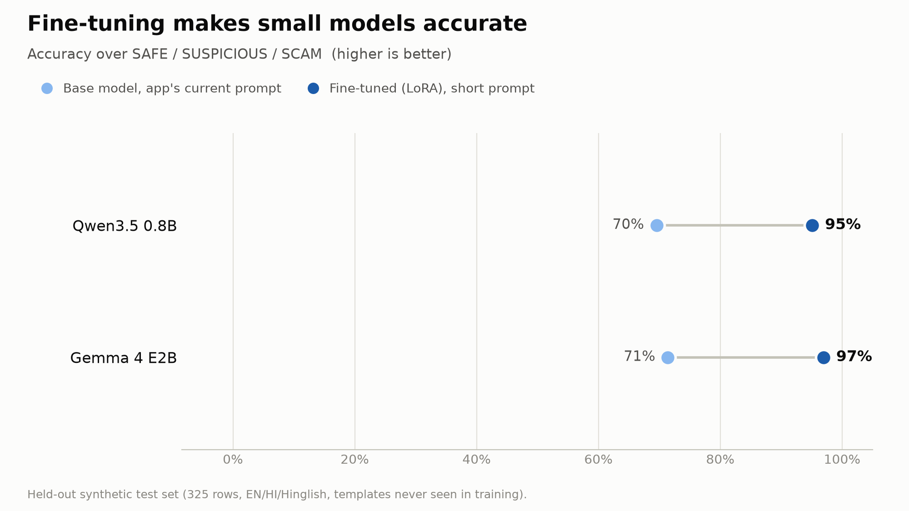
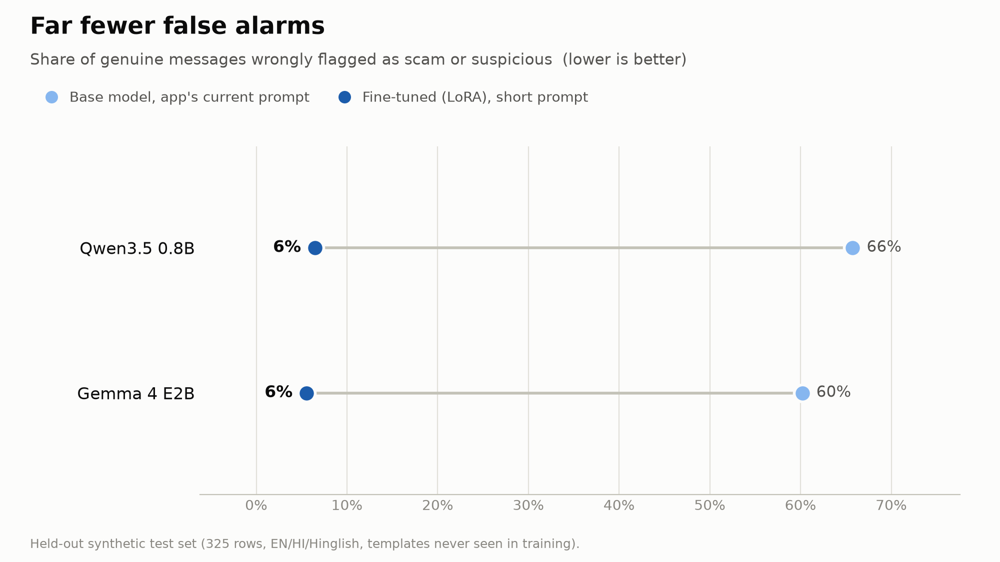
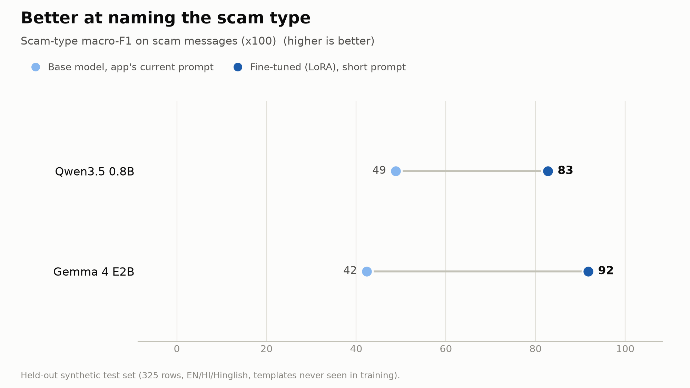
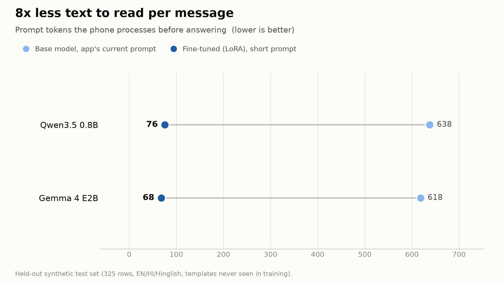
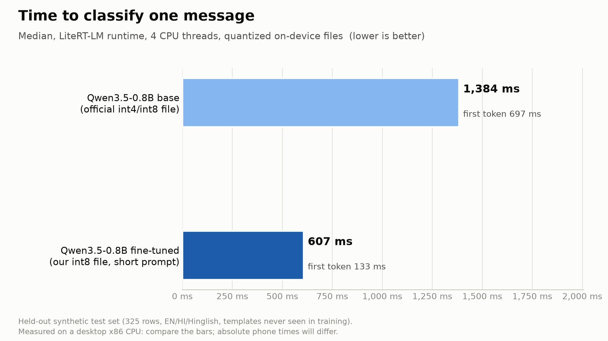

# Model benchmark

Generated by `uv run --group hf python -m scamshield_ml.bench` then `python -m scamshield_ml.bench_report`.

Data: `data/bench/test.csv`, 325 rows (EN/HI/Hinglish, SAFE/SUSPICIOUS/SCAM).

> Test rows are synthetic, held out BY TEMPLATE (no test template is trained on), written by the same authors as the training rows. Fine-tuned scores are therefore optimistic versus real traffic; only real rows in data/eval/real/ remove that bias. Accuracy is the bf16 HF checkpoint, not the quantized phone file.

## Fine-tuning at a glance

Base = the model with the prompt the app ships today (few-shot, raw). Fine-tuned = LoRA on the train split, short prompt. Charts are regenerated by `uv run --group viz python -m scamshield_ml.bench_charts` (PNG for slides, SVG to scale).

| Model | Accuracy | False alarms | Scams missed | Scam-type F1 | Prompt tokens |
|---|---|---|---|---|---|
| Qwen3.5 0.8B | 69.5% → **95.1%** | 65.7% → **6.5%** | 0.0% → **2.4%** | 0.49 → **0.83** | 638 → **76** |
| Gemma 4 E2B | 71.4% → **96.9%** | 60.2% → **5.6%** | 1.2% → **0.0%** | 0.42 → **0.92** | 618 → **68** |

### Second test set: `data/golden/eval_smoke.csv` (written separately, never trained on)

42 hand-written messages (29 SCAM, 2 SUSPICIOUS, 11 SAFE) that were already in the repo, written separately from the v2 templates, so neither their templates nor their style are in the training data. Nearest-neighbour check: no test row in either set shares 50% or more of its 4-character chunks with any training row. Expect the fine-tuned numbers here, not the main table, to be closer to real traffic. Small set: one row is 2.4 points.

| Model | Accuracy | False alarms | Scams warned (SCAM or SUSPICIOUS) |
|---|---|---|---|
| Qwen3.5 0.8B | 78.6% → **83.3%** | 54.5% → **9.1%** | 100.0% → **100.0%** |
| Gemma 4 E2B | 64.3% → **78.6%** | 45.5% → **9.1%** | 87.1% → **100.0%** |

Most remaining fine-tuned errors are SCAM answered SUSPICIOUS (still a warning). The two sets draw that line differently: e.g. 'KYC pending, account will be blocked' is SCAM here but SUSPICIOUS under the v2 template rules (no direct demand yet).

## All systems

Accuracy and macro-F1 are over the 3 labels. Recall and FPR treat SCAM or SUSPICIOUS as positive. Scam missed = real SCAM rows answered SAFE or unparseable (no warning shown). Type F1 = scam_type macro-F1 on scam rows. Phone ms is an ESTIMATE from model-card speeds (prompt/prefill + output/decode), not a measurement; output tokens count until EOS because MediaPipe has no newline stop.

| System | Acc | Macro-F1 | Recall | FPR | Scam missed | Type F1 | Unparsed | Prompt tok | Out tok | Est. phone ms | File MB | RAM MB |
|---|---|---|---|---|---|---|---|---|---|---|---|---|
| `gemma4-e2b+ft/fewshot/raw` | 99.4% | 0.99 | 99.5% | 0.0% | 0.0% | 0.96 | 0 | 618 | 28 | 1706 | 2580 | 1733 |
| `gemma4-e2b+ft/short/raw` | 96.9% | 0.96 | 98.6% | 5.6% | 0.0% | 0.92 | 0 | 68 | 28 | 719 | 2580 | 1733 |
| `qwen3.5-0.8b+ft/fewshot/litertlm-int8` | 95.7% | 0.95 | 98.2% | 5.6% | 2.4% | 0.83 | 0 | 638 | 28 | 4976 | 791 | 1300 |
| `qwen3.5-0.8b+ft/short/raw` | 95.1% | 0.94 | 97.7% | 6.5% | 2.4% | 0.83 | 0 | 76 | 27 | 1106 | 487 | 1300 |
| `qwen3.5-0.8b+ft/fewshot/raw` | 94.8% | 0.93 | 98.2% | 8.3% | 2.4% | 0.81 | 0 | 638 | 27 | 4955 | 487 | 1300 |
| `qwen3.5-0.8b+ft/short/litertlm-int8` | 94.8% | 0.93 | 97.7% | 7.4% | 2.4% | 0.82 | 0 | 76 | 28 | 1127 | 791 | 1300 |
| `distilbert-base-multilingual-cased/classifier` | 84.3% | 0.73 | 86.2% | 8.3% | 1.2% | 0.44 | 0 | 40 | 0 | - | 135 | - |
| `gemma4-e2b/fewshot/litertlm` | 72.3% | 0.66 | 96.3% | 57.4% | 0.6% | 0.62 | 3 | 619 | 55 | 2275 | 2588 | 1733 |
| `gemma4-e2b/fewshot/raw` | 71.4% | 0.65 | 98.6% | 60.2% | 1.2% | 0.42 | 2 | 618 | 29 | 1721 | 2580 | 1733 |
| `gemma4-e2b/fewshot/chat` | 63.1% | 0.64 | 75.1% | 41.7% | 21.3% | 0.44 | 59 | 626 | 31 | 1785 | 2580 | 1733 |
| `qwen3.5-0.8b/fewshot/raw` | 69.5% | 0.62 | 100.0% | 65.7% | 0.0% | 0.49 | 0 | 638 | 64 | 5760 | 487 | 1300 |
| `qwen3.5-0.8b/fewshot/litertlm-mixed48` | 62.8% | 0.47 | 99.1% | 69.4% | 0.0% | 0.49 | 0 | 638 | 64 | 5760 | 487 | 1300 |
| `qwen3.5-0.8b/fewshot/chat` | 64.0% | 0.45 | 98.2% | 61.1% | 0.0% | 0.54 | 0 | 649 | 32 | 5130 | 487 | 1300 |
| `qwen3-0.6b/fewshot/chat` | 64.0% | 0.45 | 84.8% | 46.3% | 8.5% | 0.25 | 0 | 680 | 30 | - | - | - |

## What fine-tuning changes

Each fine-tuned system against the same model's base few-shot raw prompt (what the app ships today). Prompt tokens is the ratio of prefill length (lower is faster on a phone).

| Base | Fine-tuned | Acc | Macro-F1 | Recall | FPR | Type F1 | Prompt tokens |
|---|---|---|---|---|---|---|---|
| `gemma4-e2b/fewshot/raw` | `gemma4-e2b+ft/fewshot/raw` | +28.0% | +0.34 | +0.9% | -60.2% | +0.53 | 1.00x |
| `gemma4-e2b/fewshot/raw` | `gemma4-e2b+ft/short/raw` | +25.5% | +0.31 | +0.0% | -54.6% | +0.49 | 0.11x |
| `qwen3.5-0.8b/fewshot/raw` | `qwen3.5-0.8b+ft/fewshot/litertlm-int8` | +26.2% | +0.33 | -1.8% | -60.2% | +0.34 | 1.00x |
| `qwen3.5-0.8b/fewshot/raw` | `qwen3.5-0.8b+ft/fewshot/raw` | +25.2% | +0.32 | -1.8% | -57.4% | +0.32 | 1.00x |
| `qwen3.5-0.8b/fewshot/raw` | `qwen3.5-0.8b+ft/short/litertlm-int8` | +25.2% | +0.32 | -2.3% | -58.3% | +0.33 | 0.12x |
| `qwen3.5-0.8b/fewshot/raw` | `qwen3.5-0.8b+ft/short/raw` | +25.5% | +0.32 | -2.3% | -59.3% | +0.34 | 0.12x |

## Per language (recall / FPR)

| System | en | hi | hinglish |
|---|---|---|---|
| `gemma4-e2b+ft/fewshot/raw` | 100.0% / 0.0% | 100.0% / 0.0% | 98.5% / 0.0% |
| `gemma4-e2b+ft/short/raw` | 100.0% / 8.6% | 98.6% / 5.7% | 97.0% / 2.6% |
| `qwen3.5-0.8b+ft/fewshot/litertlm-int8` | 100.0% / 0.0% | 97.3% / 0.0% | 97.0% / 15.8% |
| `qwen3.5-0.8b+ft/short/raw` | 100.0% / 0.0% | 95.9% / 0.0% | 97.0% / 18.4% |
| `qwen3.5-0.8b+ft/fewshot/raw` | 100.0% / 0.0% | 97.3% / 0.0% | 97.0% / 23.7% |
| `qwen3.5-0.8b+ft/short/litertlm-int8` | 100.0% / 0.0% | 95.9% / 0.0% | 97.0% / 21.1% |
| `distilbert-base-multilingual-cased/classifier` | 87.2% / 8.6% | 83.6% / 14.3% | 87.9% / 2.6% |
| `gemma4-e2b/fewshot/litertlm` | 94.9% / 37.1% | 94.5% / 74.3% | 100.0% / 60.5% |
| `gemma4-e2b/fewshot/raw` | 98.7% / 60.0% | 100.0% / 54.3% | 97.0% / 65.8% |
| `gemma4-e2b/fewshot/chat` | 76.9% / 22.9% | 71.2% / 48.6% | 77.3% / 52.6% |
| `qwen3.5-0.8b/fewshot/raw` | 100.0% / 45.7% | 100.0% / 77.1% | 100.0% / 73.7% |
| `qwen3.5-0.8b/fewshot/litertlm-mixed48` | 98.7% / 42.9% | 98.6% / 88.6% | 100.0% / 76.3% |
| `qwen3.5-0.8b/fewshot/chat` | 98.7% / 31.4% | 95.9% / 80.0% | 100.0% / 71.1% |
| `qwen3-0.6b/fewshot/chat` | 87.2% / 37.1% | 93.2% / 62.9% | 72.7% / 39.5% |

## Draft device-tier picks

Best macro-F1 whose published peak RAM fits the tier (unknown RAM: 2x file size). Hypothesis only, to be replaced by phone measurements.

| Tier | RAM budget for the model | Pick | Macro-F1 |
|---|---|---|---|
| A: 3-4 GB RAM | 700 MB | `distilbert-base-multilingual-cased/classifier` | 0.73 |
| B: 4-6 GB RAM | 1400 MB | `qwen3.5-0.8b+ft/fewshot/litertlm-int8` | 0.95 |
| C: 8 GB+ RAM | 4000 MB | `gemma4-e2b+ft/fewshot/raw` | 0.99 |
